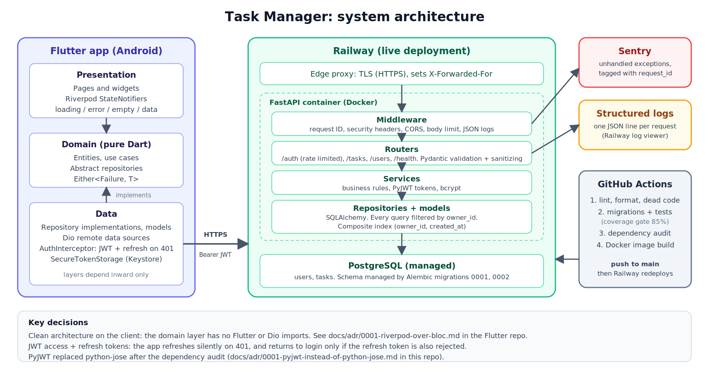

# Task Management API

[](https://github.com/shehryarhashmi800/
task-management-api1/actions/workflows/ci.yml)

Backend of the Task Manager capstone: a production-hardened REST API built with **FastAPI**,
**PostgreSQL**, **SQLAlchemy** and **Alembic**. The Flutter client lives in a separate repository
(`flutter_task_manager`).

| | |
|---|---|
| **Live API** | https://invigorating-harmony-production-bb6e.up.railway.app |
| **Swagger docs** | https://invigorating-harmony-production-bb6e.up.railway.app/docs |
| **Health check** | https://invigorating-harmony-production-bb6e.up.railway.app/health |
| **Author** | Muhammad Shehryar Hashmi, Full-Stack Engineering: FastAPI Backend and Flutter Client |


**Live API:** `https://invigorating-harmony-production-bb6e.up.railway.app/`
**Live docs:** `https://invigorating-harmony-production-bb6e.up.railway.app/docs`

---




## Features

- **Auth:** register, login, refresh and current-user endpoints; JWT access and refresh tokens;
  bcrypt password hashing.
- **Tasks:** full CRUD, scoped to the owner (you can never see or edit another user's task);
  pagination, filtering by status/priority, title search.
- **Security:** rate limiting on auth, input sanitization, security headers, body-size limit,
  dependency audit, fail-fast secret check. See [SECURITY.md](SECURITY.md).
- **Observability:** JSON logs with a UUID request ID on every line, the same ID in the
  `X-Request-ID` header and in every error body, and Sentry error tracking.
- **Consistent errors:** every failure has the same JSON shape. See
  [docs/ARCHITECTURE.md](docs/ARCHITECTURE.md#error-shape).
- **Quality:** 158 tests at 97.6% coverage, ruff lint and format, dead-code check, migrations
  checked against the models, GitHub Actions CI.
- **Documented:** every endpoint has a summary, description and documented error responses in
  Swagger.

## Quick start with Docker (recommended)

You need Docker Desktop. Nothing else.

```bash
cp .env.docker.example .env
make up
```

If you do not have `make` (common on Windows), run `docker compose up -d --build` instead.

| What | Where |
|---|---|
| API | http://localhost:8000 |
| Swagger docs | http://localhost:8000/docs |
| pgAdmin | http://localhost:5050 |

Migrations run automatically on start. Data lives in the `db_data` volume and survives
`make down` and `make up`.

```bash
make logs      # follow the API logs
make test      # run the whole test suite inside Docker
make down      # stop (data is kept)
```

## Quick start without Docker

You need Python 3.12 and PostgreSQL 16.

```bash
python -m venv venv
source venv/bin/activate            # Windows: venv\Scripts\activate
pip install -r requirements-dev.txt
cp .env.example .env                # then edit DATABASE_URL if needed
createdb taskdb                     # or create it in pgAdmin
alembic upgrade head
uvicorn app.main:app --reload
```

## Using the API in Swagger

1. Open `/docs`.
2. `POST /api/v1/auth/register` then **Try it out** to create an account.
3. `POST /api/v1/auth/login` and copy the `access_token` from the response.
4. Click **Authorize** (top right), paste the token, click **Authorize**.
5. Every padlock endpoint now works. When the token expires (30 minutes), use
   `POST /api/v1/auth/refresh`.

## Endpoints

| Method | Path | Auth | Notes |
|---|---|---|---|
| POST | `/api/v1/auth/register` | no | rate limited |
| POST | `/api/v1/auth/login` | no | rate limited |
| POST | `/api/v1/auth/refresh` | no | rate limited |
| GET | `/api/v1/auth/me` | yes | current user |
| POST | `/api/v1/tasks` | yes | |
| GET | `/api/v1/tasks` | yes | `page`, `page_size` (max 100), `status`, `priority`, `search` |
| GET | `/api/v1/tasks/{id}` | yes | `404` if not yours |
| PUT / PATCH | `/api/v1/tasks/{id}` | yes | only the fields you send change |
| DELETE | `/api/v1/tasks/{id}` | yes | `204` |
| GET | `/api/v1/users` | admin | `skip`, `limit` |
| GET | `/health` | no | `503` if the database is down |

A Postman collection with every request is in `postman_collection.json` (import it and set the
`base_url` variable).

### Example: a page of tasks

```json
{
  "total": 42,
  "page": 1,
  "page_size": 20,
  "has_more": true,
  "items": [
    { "id": "…", "title": "Buy milk", "status": "todo", "priority": "medium", "…": "…" }
  ]
}
```

## Configuration

All settings are environment variables (a `.env` file is read in development).

| Variable | Default | What it does |
|---|---|---|
| `DATABASE_URL` | local Postgres | Where the data lives |
| `SECRET_KEY` | dev placeholder | Signs JWTs. **Production refuses to start unless this is 32+ random characters** |
| `ENVIRONMENT` | `development` | `production` turns on HSTS and the secret check |
| `ACCESS_TOKEN_EXPIRE_MINUTES` | `30` | Access token lifetime |
| `REFRESH_TOKEN_EXPIRE_DAYS` | `7` | Refresh token lifetime |
| `CORS_ORIGINS` | localhost | Comma-separated allowed browser origins |
| `LOG_LEVEL` / `LOG_FORMAT` | `INFO` / `json` | `LOG_FORMAT=text` is easier to read locally |
| `SENTRY_DSN` | empty | Turns Sentry on when set |
| `SENTRY_TRACES_SAMPLE_RATE` | `0.0` | Performance tracing sample rate |
| `RATE_LIMIT_ENABLED` | `true` | Master switch |
| `RATE_LIMIT_LOGIN` / `_REGISTER` / `_REFRESH` | `5/minute` / `5/minute` / `30/minute` | Per-IP limits |
| `TRUST_PROXY_HEADERS` | on in production | Read the client IP from `X-Forwarded-For` |
| `MAX_REQUEST_BODY_BYTES` | `1000000` | Larger bodies get `413` |
| `ENABLE_DEBUG_ROUTES` | `false` | Enables the deliberate-error route used to test Sentry |

Generate a production secret:

```bash
python -c "import secrets; print(secrets.token_urlsafe(48))"
```

## Logging and request IDs

Every request gets a UUID. It appears in the `X-Request-ID` response header, in every error body
and in every log line for that request:

```json
{"timestamp": "2026-10-11T05:43:37+00:00", "level": "WARNING", "logger": "task_api",
 "message": "POST /api/v1/auth/login -> 429", "request_id": "94a5264d-06f1-417f-b523-9f9b8296cf24",
 "method": "POST", "path": "/api/v1/auth/login", "status_code": 429,
 "duration_ms": 1.16, "client_ip": "198.51.100.7"}
```

When someone reports a problem, ask for the `request_id` and search the logs for it.
Log levels: `INFO` for 2xx/3xx, `WARNING` for 4xx, `ERROR` for 5xx. Tracebacks are logged but never
sent to the client.

## Error tracking with Sentry

1. Create a free project at sentry.io (platform: *FastAPI*) and copy its **DSN**.
2. Set `SENTRY_DSN` on the server (Railway: *Variables*), and redeploy.
3. **Prove it works** with a deliberate error:
   1. Set `ENABLE_DEBUG_ROUTES=true` and redeploy.
   2. Open `https://<your-url>/api/v1/debug/sentry-test`. You get a safe `500` with a `request_id`.
   3. In Sentry, a `ZeroDivisionError: Deliberate Sentry test error` appears, tagged with that same
      `request_id`.
   4. **Remove `ENABLE_DEBUG_ROUTES`** again.

Sentry is configured with `send_default_pii=False` and `max_request_body_size="never"`, so
passwords in request bodies are never sent. The test suite includes an automated version of this
check (`tests/test_observability.py`).

## Tests

```bash
pytest                                              # all tests
pytest --cov=app --cov-report=term-missing          # with coverage
make coverage                                       # also writes an HTML report to htmlcov/
```

158 tests, 97.6% coverage (CI fails below 85%):

| File | Covers |
|---|---|
| `test_auth.py`, `test_auth_hardening.py` | register/login/refresh, forged, expired and wrong-type tokens, `alg: none`, inactive users, password rules, admin access |
| `test_tasks.py`, `test_health_and_tasks_extra.py` | CRUD, ownership (user B cannot touch user A's tasks), pagination, filters |
| `test_sanitization.py` | XSS payloads, SQL-injection strings, LIKE wildcards |
| `test_security.py` | security headers, CORS, body-size limit, HSTS |
| `test_rate_limit.py` | `429` after the limit, per-IP buckets, spoofed headers ignored |
| `test_request_id_and_logging.py` | request IDs, log fields, log-forging protection |
| `test_observability.py` | safe 500s, Sentry capture |
| `test_config.py`, `test_openapi.py`, `test_migrations.py` | startup checks, every endpoint documented, migrations up/down and in sync with the models |

The tests use a separate database whose name must end in `_test`. It is created automatically,
and the tests refuse to run against anything else because they wipe it.

## Deploying to Railway

The service is already deployed; this is how to redeploy or recreate it.

1. **Set the variables** on the API service (Railway: *Variables*):
   - `SECRET_KEY`: a **fresh random value of 32+ characters** (see above). The app will not
     start in production with a short or placeholder key.
   - `ENVIRONMENT=production`
   - `DATABASE_URL`: reference the Postgres service, `${{Postgres.DATABASE_URL}}`. If this URL
     starts with `postgresql://`, change it to `postgresql+psycopg2://`.
   - `CORS_ORIGINS`: the origins of any web client (the Android app does not need CORS).
   - `SENTRY_DSN`: optional.
2. **Run migrations** against the Railway database whenever the schema changes (this release adds
   migration `0002`):
   ```bash
   export DATABASE_URL="<the Railway Postgres URL, postgresql+psycopg2://…>"
   alembic upgrade head
   ```
   You can also set `alembic upgrade head` as the service's *Pre-deploy command* if your
   Railway settings show one.
3. **Deploy.** Railway rebuilds on every push to `main`.
4. **Check:** `GET /health` returns `{"status":"ok","database":"up",…}`.

## Troubleshooting

| Symptom | Cause and fix |
|---|---|
| Deploy crashes at startup with `SECRET_KEY must be a random string of at least 32 characters` | Intended safety check. Set a strong `SECRET_KEY` |
| The task list is slow once users have thousands of tasks | Migration `0002` (the list index) has not been applied to the Railway database. Nothing breaks without it; it only affects speed |
| `429 Too many requests` while testing | Login/register/refresh are limited per IP (5/min by default). Wait for `Retry-After` |
| Everyone gets `429` at once in production | The proxy IP is being used for all users. Check `client_ip` in the logs and that `TRUST_PROXY_HEADERS` is on |
| `database "taskdb_test" does not exist` | Should not happen (it is created automatically); check the DB user can create databases |
| Swagger **Authorize** rejects the token | Paste only the token, without the word `Bearer` |

## Project structure

```
app/
  core/          security (JWT, bcrypt), rate limiting, logging, sanitizing, Sentry, client IP
  models/        SQLAlchemy tables
  schemas/       Pydantic request/response models (validation + sanitizing)
  repositories/  all database queries, owner-scoped
  services/      business logic
  routers/       HTTP endpoints and OpenAPI docs
  middleware.py  request ID, security headers, request logging, body limit
  exceptions.py  error classes and the one JSON error shape
alembic/         migrations (0001 schema, 0002 task-list index)
tests/           158 tests
docs/            architecture, auth sequence diagram, ADR, performance notes, demo script
```

## More documentation

- [docs/ARCHITECTURE.md](docs/ARCHITECTURE.md): layers, request lifecycle, error shape, database
- [docs/SEQUENCE_AUTH.md](docs/SEQUENCE_AUTH.md): register, login, refresh and expiry sequence diagram
- [docs/adr/0001-pyjwt-instead-of-python-jose.md](docs/adr/0001-pyjwt-instead-of-python-jose.md): a decision record
- [docs/PERFORMANCE.md](docs/PERFORMANCE.md): index measurements and a load test
- [docs/DEMO_SCRIPT.md](docs/DEMO_SCRIPT.md): the 15-minute demo
- [SECURITY.md](SECURITY.md): controls, audit history and known limitations

## Known limitations

See [SECURITY.md](SECURITY.md#known-limitations-honest-list). In short: rate-limit counters are
in memory (single instance), refresh tokens cannot be revoked, and there is no email verification
or password reset.
