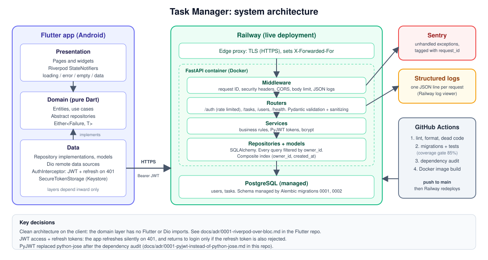
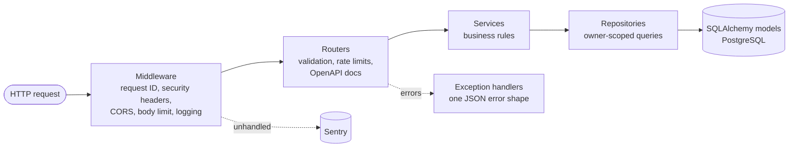
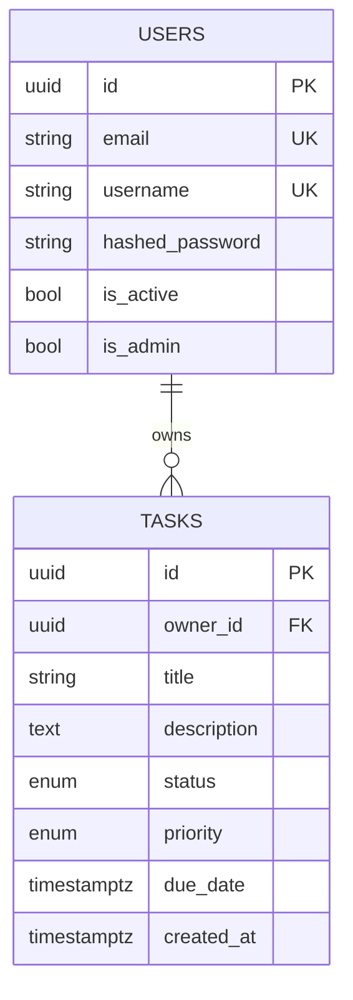

# Architecture



(`architecture.svg` is the editable source; `architecture.png` is the same picture for slides.)

## Backend layers



| Layer | Folder | Responsibility | Must not |
|---|---|---|---|
| Middleware | `app/middleware.py` | Request ID, security headers, request log, body limit | Contain business logic |
| Routers | `app/routers/` | HTTP details: paths, status codes, docs, rate limits | Talk to the database directly |
| Schemas | `app/schemas/` | Validate and sanitize input; shape output | Know about the database |
| Services | `app/services/` | Business rules (who may do what) | Know about HTTP |
| Repositories | `app/repositories/` | All SQL, always scoped to an owner | Raise HTTP errors |
| Models | `app/models/` | Table definitions | Contain logic |
| Core | `app/core/` | Security, rate limiting, logging, sanitizing, Sentry | Depend on routers |

## Request lifecycle

1. The middleware gives the request a UUID (`X-Request-ID`) and starts a timer.
2. The router validates the input (Pydantic) and checks the rate limit.
3. The `get_current_user` dependency verifies the JWT and loads the user.
4. The service applies the rule; the repository runs the owner-scoped query.
5. On success the response is serialised; on any error an exception handler produces the standard
   body `{error, message, details?, request_id}`.
6. The middleware adds the security headers and writes one JSON log line with the request ID,
   status, duration and client IP.

## Error shape

Every failure, whether validation, auth, missing, rate limited or a server crash, looks like this:

```json
{
  "error": "validation_error",
  "message": "One or more fields failed validation",
  "details": [{ "field": "title", "message": "Value error, title must not be empty" }],
  "request_id": "0b9f1c52-6f5e-4a7a-9d0b-2f1c1f2d9a11"
}
```

| Status | `error` code |
|---|---|
| 401 | `invalid_token`, `invalid_credentials` |
| 403 | `forbidden`, `inactive_user` |
| 404 | `not_found` |
| 405 | `method_not_allowed` |
| 409 | `already_exists`, `conflict` |
| 413 | `payload_too_large` |
| 422 | `validation_error` |
| 429 | `rate_limited` |
| 500 | `internal_error` (generic message; details only in logs and Sentry) |

## Database



Indexes on `tasks`: `(owner_id, created_at)` serves the list query; `status` and `priority`
support filters. See [PERFORMANCE.md](PERFORMANCE.md) for the measurements behind this.
