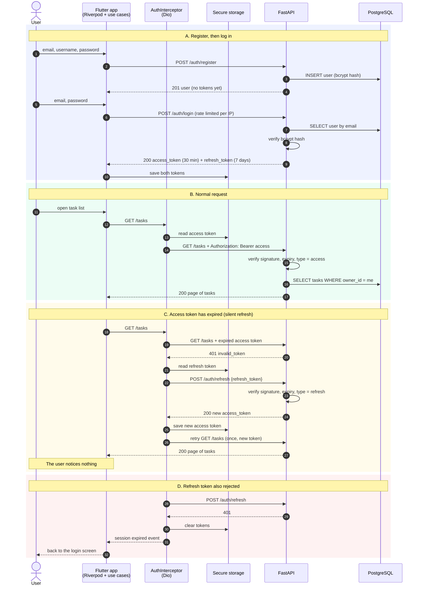

# Authentication flow

How the Flutter app and the API handle register, login, normal requests and an expired token.
(The diagram is Mermaid, which GitHub draws automatically.)

## Details worth knowing

- **One refresh at a time.** If several requests get a 401 together, the interceptor performs a
  single refresh and the others wait for its result instead of each calling `/auth/refresh`.
- **Retried once.** A request that fails again after refreshing is not retried a second time, which
  prevents an endless loop.
- **Rate limits.** `login`, `register` and `refresh` are limited per IP address. If the app is
  rate limited it gets `429` with a `Retry-After` header and shows the server's message.
- **Why 404 and not 403 for someone else's task.** The API answers `404` so it never confirms that
  another user's task exists.
